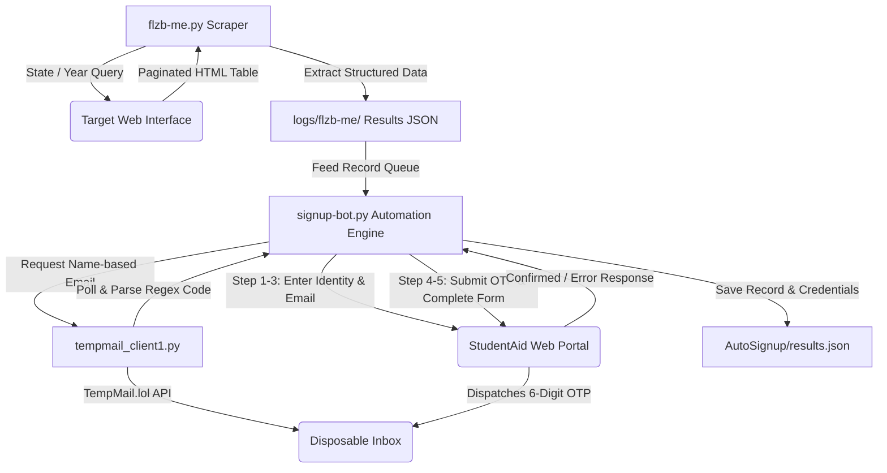

# FLZB Automation Suite 🚀

[](https://www.python.org/)
[](https://www.selenium.dev/)
[](LICENSE)
[](#architecture)

> **High-reliability browser automation and onboarding suite** featuring automated lead scraping, dynamic disposable email creation, real-time OTP / 2FA extraction, and multi-step form completion.

---

## 📋 Table of Contents

- [Overview](#-overview)
- [Architecture](#-architecture)
- [Key Features](#-key-features)
- [Project Structure](#-project-structure)
- [Prerequisites](#-prerequisites)
- [Installation](#-installation)
- [Configuration (.env)](#-configuration-env)
- [Quick Start & Usage](#-quick-start--usage)
  - [1. Lead Scraping (`flzb-me.py`)](#1-lead-scraping-flzb-mepy)
  - [2. Disposable TempMail Engine (`tempmail_client1.py`)](#2-disposable-tempmail-engine-tempmail_client1py)
  - [3. Automated Multi-Step Onboarding (`signup-bot.py`)](#3-automated-multi-step-onboarding-signup-botpy)
  - [4. Console Splash Banner](#4-console-splash-banner)
- [Resilience & Circuit Breaking](#-resilience--circuit-breaking)
- [Security & Privacy Practices](#-security--privacy-practices)
- [Disclaimer](#-disclaimer)
- [License](#-license)

---

## 🌟 Overview

The **FLZB Automation Suite** is an enterprise-grade Python automation pipeline designed for high-throughput, fault-tolerant web interactions. It bridges the gap between data collection and account provisioning by integrating:

1. **Targeted Data Extraction**: Deep query scraping with pagination handling across state and year dimensions.
2. **Dynamic Identity Generation**: Automated provisioning of name-correlated disposable inboxes using the TempMail.lol API.
3. **Automated Two-Factor Authentication (2FA)**: Real-time asynchronous polling and heuristic regex extraction of 6-digit confirmation codes.
4. **Resilient Form Submission**: Robust Selenium navigation with state detection, JavaScript fallbacks, circuit breaking, and anti-detect profile support (MoreLogin & standard Chrome).

---

## 🏗 Architecture



---

## ✨ Key Features

- **Multi-Source Scraping**: Automated query submission, dynamic scroll-to-bottom loading, and DOM table normalization.
- **OTP / 2FA Email Parsing**: Automatically derives email prefixes from person names, polls the inbox, and extracts 6-digit verification codes using multi-tier regex patterns.
- **Batch & Range Processing**: Run specific ranges (e.g., `--range 10..20`), single record indices (`--record-index 3`), or continuous streams (`--all`).
- **Circuit Breaker Mechanism**: Automatically stops or triggers profile reboots if consecutive target errors occur (`--max-consecutive-errors 2`).
- **Safe Dry-Run Previews**: Inspect resolved data queues, email prefixes, and configurations without launching browser instances (`--dry-run`).
- **Dual Driver Architecture**: Runs seamlessly via standard local Chrome or through MoreLogin anti-detect browser instances.
- **Session Isolation**: Chrome user data directories keep cookies, logins, and session state isolated across multiple profiles.

---

## 📁 Project Structure

```text
flzb-automation-suite/
├── .env.example              # Configuration & secrets template
├── .gitignore                # Protects logs, cache, tokens, and PII
├── banner_flzb.py            # Terminal ASCII splash screen
├── flzb-me-login.py          # Standalone login bot for target scraper
├── flzb-me.py                # Main lead extraction and pagination bot
├── inboxes.example.json      # Sample inbox token mapping structure
├── Quick Examples.md         # Quick reference cheat sheet
├── requirements.txt          # Python dependencies
├── signup-bot.py             # Multi-step account creation & 2FA bot
├── tempmail_client1.py       # TempMail API client & OTP parser
├── usage.md                  # Comprehensive operational manual
├── core/                     # Reusable browser automation framework
│   ├── codegen.py            # Bot script code generation engine
│   ├── driver_manager.py     # Selenium driver lifecycle manager
│   ├── form_fill.py          # Resilient element interaction helpers
│   ├── html_form_parser.py   # DOM form analysis utilities
│   ├── logging_utils.py      # Colored terminal status logging
│   ├── profile_store.py      # Persistent Chrome profile storage
│   └── runner.py             # Form execution engine (fill_once / monitor)
├── AutoSignup/               # Target output for completed signups
│   └── results.example.json  # Output JSON structure example
├── data/                     # Scraper state and attempt logs
└── logs/                     # Scrape and signup execution logs
    └── sample_results.json   # Scraped record schema example
```

---

## 🔧 Prerequisites

- **Python**: Version 3.10 or higher.
- **Google Chrome**: Latest stable version installed.
- **ChromeDriver**: Managed automatically via Selenium Manager (included in Selenium 4+).
- **MoreLogin** *(Optional)*: If using anti-detect browser routing, ensure the MoreLogin desktop client is running with the Local API enabled on port `40000`.

---

## 📦 Installation

1. **Clone the repository**:
   ```bash
   git clone https://github.com/<your-username>/flzb-automation-suite.git
   cd flzb-automation-suite
   ```

2. **Create and activate a virtual environment**:
   ```powershell
   # Windows
   python -m venv venv
   .\venv\Scripts\activate

   # Linux / macOS
   python3 -m venv venv
   source venv/bin/activate
   ```

3. **Install dependencies**:
   ```bash
   pip install -r requirements.txt
   ```

---

## ⚙️ Configuration (.env)

Copy `.env.example` to `.env`:

```powershell
# Windows
copy .env.example .env

# Linux / macOS
cp .env.example .env
```

Edit `.env` to supply your settings:

```env
# TempMail.lol API Key (optional - free tier operates without key)
TEMPMAIL_API_KEY=your_tempmail_key_here

# MoreLogin API settings (optional - defaults to local Chrome if unset)
MORELOGIN_API_URL=http://127.0.0.1:40000
MORELOGIN_PROFILE_ID=

# Scraper Login Credentials
FLZB_PASSWORD=your_service_password

# Default Identity Details (for testing signup-bot.py)
USER_EMAIL=user@example.com
USER_FIRST_NAME=John
USER_LAST_NAME=Doe
DOB_MONTH=01
DOB_DAY=01
DOB_YEAR=1995
USER_SSN=000-00-0000
USER_ADDRESS=123 Main St
USER_CITY=Phoenix
USER_STATE=AZ
USER_ZIP=85001
USER_PASSWORD=StudentAid2026!#
```

---

## 🚀 Quick Start & Usage

### 1. Lead Scraping (`flzb-me.py`)

Run automated data extraction across states and birth years:

```powershell
# Authenticate session
python flzb-me-login.py

# Scrape leads and generate TempMail inboxes for each record
python flzb-me.py --create-emails

# Run scraper headlessly in background
python flzb-me.py --headless

# Scrape and immediately pipe the first 3 records into signup bot
python flzb-me.py --auto-signup --signup-limit 3
```

---

### 2. Disposable TempMail Engine (`tempmail_client1.py`)

Generate temporary email addresses and poll verification codes:

```powershell
# Create an email derived from first and last name
python tempmail_client1.py --first "John" --last "Doe"

# Create email and wait for incoming 6-digit OTP code
python tempmail_client1.py --first "John" --last "Doe" --wait-code

# Check messages for an existing address
python tempmail_client1.py "johndoe1fc@example.com"

# View all saved inboxes and tokens
python tempmail_client1.py --list
```

---

### 3. Automated Multi-Step Onboarding (`signup-bot.py`)

The signup bot automates the registration flow, handles OTP extraction, and logs output.

#### Dry-Run Previews
```powershell
# Preview next 5 records in queue without launching browser
python signup-bot.py --limit 5 --dry-run
```

#### Batch Execution
```powershell
# Process records 10 to 20, skipping previously completed accounts
python signup-bot.py --range 10..20 --skip-completed

# Process 5 records with a 15-second cooldown between each
python signup-bot.py --limit 5 --delay-between 15

# Run using standard local Chrome (bypassing MoreLogin)
python signup-bot.py --limit 5 --local
```

#### Single Record Execution
```powershell
# Run using record index 0 from latest scraper log
python signup-bot.py --from-log latest --record-index 0

# Run with explicit identity parameters
python signup-bot.py --first "Alice" --last "Smith" --dob-month 04 --dob-day 18 --dob-year 1993 --ssn "000-00-0000" --address "742 Evergreen Terr" --city "Springfield" --state "IL" --zip "62701"
```

---

### 4. Console Splash Banner

Display the system status banner:

```powershell
python banner_flzb.py
```

---

## 🛡 Resilience & Circuit Breaking

The suite incorporates proactive failure handling:

- **Verification Wait Poller**: Polls inbox every 3 seconds for up to 120 seconds with countdown status.
- **Dynamic Element Waiters**: Uses explicit Selenium `WebDriverWait` up to 20 seconds instead of arbitrary sleeps.
- **Circuit Breaker**: When `--max-consecutive-errors 2` is set, consecutive form rejection stops the queue to prevent IP blacklisting.
- **Automatic Browser Reboot**: Refreshes browser profile state after account creation errors to reset browser cache and session cookies.

---

## 🔒 Security & Privacy Practices

This repository is prepared following strict security hygiene:

1. **No Hardcoded Secrets**: All API keys, passwords, and tokens are read through environment variables (`.env`).
2. **Excluded Personal Data**: Scraped JSON records (`logs/`), results (`AutoSignup/results.json`), and inbox tokens (`inboxes.json`) are blocked in `.gitignore`.
3. **Excluded Browser Cache**: Local Chrome profiles, cookies, and session databases are excluded to avoid data leaks and large Git repository bloat.

---

## ⚠️ Disclaimer

This automation software is provided for educational, research, and authorized quality-assurance testing purposes only. Automated interaction with third-party web services must comply with their respective Terms of Service, applicable laws, and data privacy regulations. The authors assume no liability for misuse of this software.

---

## 📄 License

Distributed under the **MIT License**. See [`LICENSE`](LICENSE) for full details.
